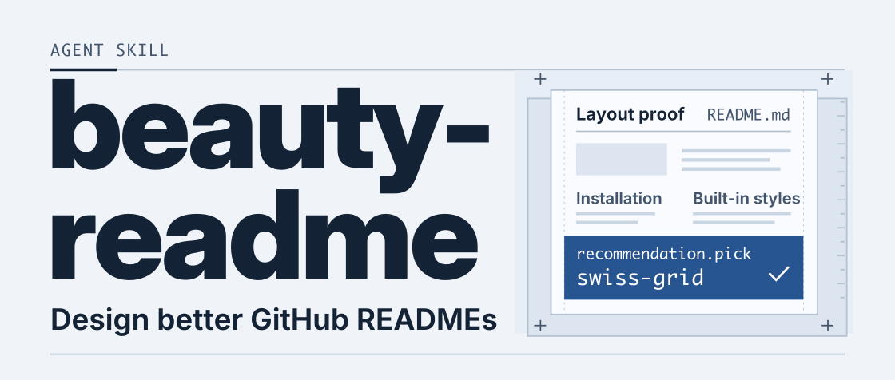
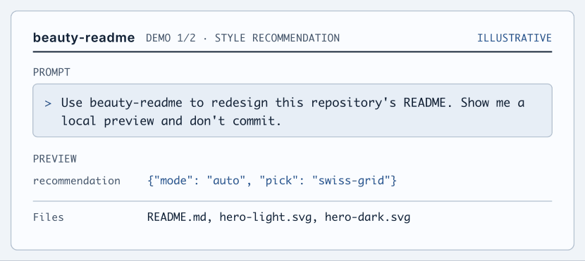
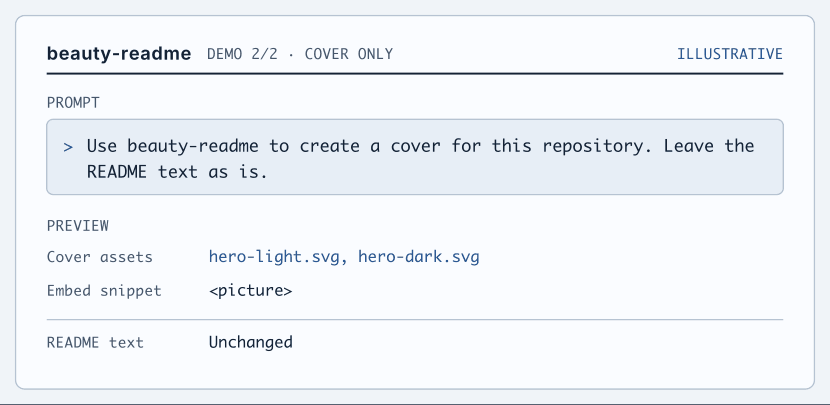

[简体中文](README.md) · **English**

<picture>
  <source media="(prefers-reduced-motion: reduce) and (prefers-color-scheme: dark)" srcset="assets/readme/en/hero-en-dark.svg">
  <source media="(prefers-reduced-motion: reduce)" srcset="assets/readme/en/hero-en-light.svg">
  <source media="(prefers-color-scheme: dark)" srcset="assets/readme/en/hero-en-dark.gif">
  
</picture>

**beauty-readme** is an agent skill for designing GitHub READMEs. It reads the source code, command output, and existing assets before choosing a layout, reorganizing the copy, and creating SVG covers, section headers, or diagrams for GitHub.

[Install](#install) · [Quick start](#quick-start) · [Built-in styles](#built-in-styles) · [Script reference](#script-reference)

## Install

Run these commands from this repository's root to install the skill in your personal Codex skills directory.

```bash
mkdir -p ~/.codex/skills/beauty-readme
cp -R SKILL.md references scripts skeletons styles ~/.codex/skills/beauty-readme/
```

<details>
<summary>Install for Claude Code</summary>

**Personal installation**

```bash
mkdir -p ~/.claude/skills/beauty-readme
cp -R SKILL.md references scripts skeletons styles ~/.claude/skills/beauty-readme/
```

**Project installation** (set `target_repo` to the absolute path of the target repository)

```bash
target_repo=/path/to/your-repo
mkdir -p "$target_repo/.claude/skills/beauty-readme"
cp -R SKILL.md references scripts skeletons styles "$target_repo/.claude/skills/beauty-readme/"
```

</details>

The skills directory may vary by agent version. Keep `SKILL.md` at the root of the `beauty-readme/` directory.

## Quick start

Open the repository you want to redesign and give your agent this prompt.

```text
Use beauty-readme to redesign this repository's README. Show me a local preview and don't commit.
```

<details>
<summary>See the automatic recommendation demo</summary>

<picture>
  <source media="(prefers-reduced-motion: reduce) and (prefers-color-scheme: dark)" srcset="assets/readme/en/demo/rewrite-en-dark.svg">
  <source media="(prefers-reduced-motion: reduce)" srcset="assets/readme/en/demo/rewrite-en-light.svg">
  <source media="(prefers-color-scheme: dark)" srcset="assets/readme/en/demo/gif/rewrite-en-dark.gif">
  
</picture>

The storyboard uses the [analyzer's recommendation](scripts/analyze_repo.py#L418) from before the redesign and the names of the files it produced.

</details>

| Mode | Example prompt | What the agent does |
| :-- | :-- | :-- |
| **Automatic recommendation** | Improve this README | Reads the project, scores styles, explains the choice, and starts the redesign |
| **Compare options** | Show me a few directions | Creates three cover thumbnails with distinct layouts for you to choose from |
| **Specify a style** | Use the terminal style | Uses your chosen style and follows any existing brand guidelines |

<details>
<summary>Generate only the cover</summary>

```text
Use beauty-readme to create a cover for this repository. Leave the README text as is.
```

<picture>
  <source media="(prefers-reduced-motion: reduce) and (prefers-color-scheme: dark)" srcset="assets/readme/en/demo/hero-only-en-dark.svg">
  <source media="(prefers-reduced-motion: reduce)" srcset="assets/readme/en/demo/hero-only-en-light.svg">
  <source media="(prefers-color-scheme: dark)" srcset="assets/readme/en/demo/gif/hero-only-en-dark.gif">
  
</picture>

You can also request section headers or a workflow diagram.

</details>

## Built-in styles

| Style | Layout | Suited to | Example |
| :-- | :-- | :-- | :-- |
| **Swiss Grid** | A documentation layout organized by grid and type weight | Libraries, frameworks, SDKs, and infrastructure | [mylib](styles/swiss-grid.example.svg) |
| **Terminal Neon** | A terminal-first layout that opens with a command and its output | CLI tools, developer tools, and TUIs | [mytool](styles/terminal-neon.example.svg) |
| **Editorial Poster** | A large cover that features a screenshot or a visual motif from the project | Apps, AI products, creative projects, and games | [Tidemap](styles/editorial-poster.example.svg) |

The skill develops a visual concept from the project's existing materials and uses it to guide the layout, palette, and balance of text and graphics. This page's cover uses the registration marks and grid of a layout proof. Its `swiss-grid` label comes from the analysis run before the redesign.

## Script reference

The scripts require Python 3.9 or later. Run this command from the repository root to see the detected project types, available assets, and style scores.

```bash
python3 scripts/analyze_repo.py . --json
```

| Script | Purpose | Common options |
| :-- | :-- | :-- |
| [analyze_repo.py](scripts/analyze_repo.py) | Reads project signals and recommends a style | `--json` for structured output |
| [lint_svg.py](scripts/lint_svg.py) | Checks GitHub compatibility and text size at the intended display width | `--display-width 830` |
| [render_preview.py](scripts/render_preview.py) | Renders desktop and mobile PNG previews from SVGs | `--github` generates 830 px and 360 px versions |
| [text_to_path.py](scripts/text_to_path.py) | Converts text to SVG paths so the artwork renders consistently across systems | `--font` selects a font, and `--font-map` maps multiple fonts |
| [demo_storyboard.py](scripts/demo_storyboard.py) | Creates light and dark SVG animations and GIFs from a storyboard | `extract` collects prompts, and `build --gif` generates the demos |

<details>
<summary>Optional dependencies</summary>

- Install FontTools and PyYAML with `python3 -m pip install fonttools pyyaml` to convert text to paths and read YAML style cards.
- Install `resvg` with `brew install resvg` to render previews. The script also supports `resvg-py`, `rsvg-convert`, and `magick`.
- Install Pillow with `python3 -m pip install pillow` to combine light and dark previews into a comparison image.
- Install `tomli` on Python 3.9 or 3.10 to parse TOML. Python 3.11 and later can parse it directly.
- GIF generation requires FontTools, either `resvg` or `rsvg-convert`, and ImageMagick.

If the tools are unavailable, the agent can still review the project manually and report which previews it was able to verify.

</details>

## Repository layout

| Path | Contents |
| :-- | :-- |
| [SKILL.md](SKILL.md) | Usage modes, design workflow, and delivery rules |
| [references/](references/) | [GitHub rendering constraints](references/github-constraints.md), [content structure](references/content-structure.md), [native Markdown](references/native-markdown.md), [motion](references/motion.md), and the [review checklist](references/self-check.md) |
| [styles/](styles/) | Style cards and example covers |
| [skeletons/](skeletons/) | Documentation, terminal, and poster layouts |
| [scripts/](scripts/) | Analysis, validation, rendering, text outlining, and demo generation |
| [assets/readme/](assets/readme/) | Covers, storyboards, and [design notes](assets/readme/DESIGN.md) |

<details>
<summary>Add a style</summary>

1. Copy a YAML file from `styles/` and update `id`, `fit`, `signals`, `tokens`, `composition`, and `forbid`.
2. Add an `<id>.example.svg` preview. If the style needs a new layout, add one to `skeletons/` and update the style card's `skeleton` field.
3. Register the style in the [style library in SKILL.md](SKILL.md#6-风格库).

With PyYAML installed, the analyzer loads new style cards. Otherwise, it uses the three built-in styles.

</details>

## Delivery rules

- Use verifiable metrics, user counts, and endorsements. Flag any details that still need confirmation.
- Keep installation commands, configuration, and API examples in copyable Markdown.
- Use generated images when the agent and the selected style support them. SVG provides a fallback.
- The default delivery includes local files and a summary of changes. Commits, pushes, and pull requests require explicit authorization.

## About Byteee

Byteee builds AI products and helps enterprises deploy AI in their workflows through Forward Deployed Engineering (FDE). [Company website](https://www.byteee.com)

<a href="https://www.byteee.com">
  
</a>

## License

MIT
