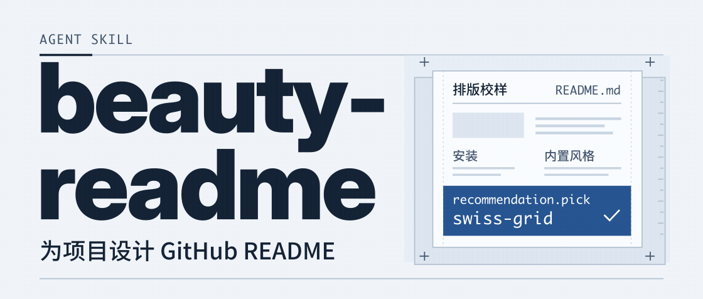
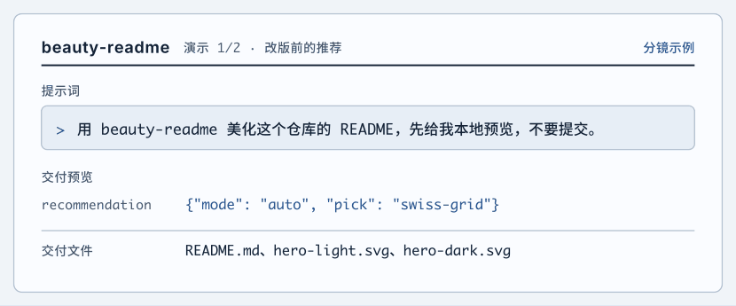
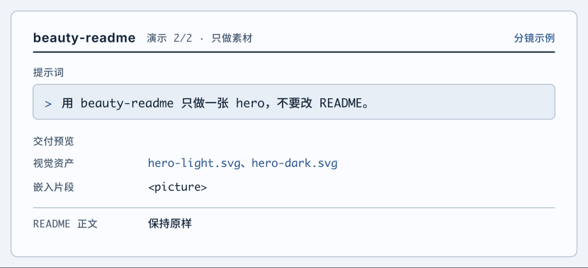

**简体中文** · [English](README.en.md)

<picture>
  <source media="(prefers-reduced-motion: reduce) and (prefers-color-scheme: dark)" srcset="assets/readme/hero-dark.svg">
  <source media="(prefers-reduced-motion: reduce)" srcset="assets/readme/hero-light.svg">
  <source media="(prefers-color-scheme: dark)" srcset="assets/readme/hero-dark.gif">
  
</picture>

**beauty-readme** 是一个为 GitHub 项目设计 README 的 Agent 技能。它先读源码、命令输出和现有素材，再选版式、重排正文，制作可在 GitHub 显示的 SVG 封面、章节图或流程图。

[安装](#安装) · [快速上手](#快速上手) · [内置风格](#内置风格) · [脚本速查](#脚本速查)

## 安装

在本仓库根目录运行以下命令，将技能安装到 Codex 的个人技能目录。

```bash
mkdir -p ~/.codex/skills/beauty-readme
cp -R SKILL.md references scripts skeletons styles ~/.codex/skills/beauty-readme/
```

<details>
<summary>Claude Code 安装方式</summary>

**个人级**

```bash
mkdir -p ~/.claude/skills/beauty-readme
cp -R SKILL.md references scripts skeletons styles ~/.claude/skills/beauty-readme/
```

**项目级**（先把 `target_repo` 换成目标仓库的绝对路径）

```bash
target_repo=/path/to/your-repo
mkdir -p "$target_repo/.claude/skills/beauty-readme"
cp -R SKILL.md references scripts skeletons styles "$target_repo/.claude/skills/beauty-readme/"
```

</details>

Agent 的技能目录可能随版本而异。`SKILL.md` 应位于 `beauty-readme/` 根目录。

## 快速上手

打开要美化的仓库，发给 Agent：

```text
用 beauty-readme 美化这个仓库的 README，先给我本地预览，不要提交。
```

<details>
<summary>查看自动推荐演示</summary>

<picture>
  <source media="(prefers-reduced-motion: reduce) and (prefers-color-scheme: dark)" srcset="assets/readme/demo/rewrite-dark.svg">
  <source media="(prefers-reduced-motion: reduce)" srcset="assets/readme/demo/rewrite-light.svg">
  <source media="(prefers-color-scheme: dark)" srcset="assets/readme/demo/gif/rewrite-dark.gif">
  
</picture>

这段分镜使用了改版前的 [分析脚本](scripts/analyze_repo.py#L418) 输出和本页的实际交付文件。

</details>

| 方向 | 怎么说 | Agent 会做什么 |
| :-- | :-- | :-- |
| **自动推荐** | 美化一下 README | 读项目、给风格打分，说明选择后开始制作 |
| **多方案对比** | 给我几个方向看看 | 做三张不同版式的封面缩略稿，供你选择 |
| **指定风格** | 用终端风格 | 直接采用指定风格；已有品牌规范时沿用品牌视觉 |

<details>
<summary>只生成封面素材</summary>

```text
用 beauty-readme 只做一张 hero，不要改 README。
```

<picture>
  <source media="(prefers-reduced-motion: reduce) and (prefers-color-scheme: dark)" srcset="assets/readme/demo/hero-only-dark.svg">
  <source media="(prefers-reduced-motion: reduce)" srcset="assets/readme/demo/hero-only-light.svg">
  <source media="(prefers-color-scheme: dark)" srcset="assets/readme/demo/gif/hero-only-dark.gif">
  
</picture>

也可以在提示词里指定章节标题图或流程图。

</details>

## 内置风格

| 风格 | 版式 | 适合 | 示例 |
| :-- | :-- | :-- | :-- |
| **瑞士网格** | 文档型，用网格和字重组织信息 | 库、框架、SDK、基础设施 | [mylib](styles/swiss-grid.example.svg) |
| **霓虹终端** | 终端型，首屏展示命令和输出 | CLI、开发工具、TUI | [mytool](styles/terminal-neon.example.svg) |
| **编辑海报** | 海报型，把截图或项目母题放进大封面 | 应用、AI 产品、创作项目、游戏 | [Tidemap](styles/editorial-poster.example.svg) |

技能根据项目的真实素材确定视觉概念，再组合版式、视觉语言、配色和图文比重。本页的封面借用了排版校样的裁切线和网格，并标出了改版前分析脚本返回的 `swiss-grid`。

## 脚本速查

脚本需要 Python 3.9 或更新版本。在本仓库根目录运行以下命令可查看项目类型、素材清单和风格得分。

```bash
python3 scripts/analyze_repo.py . --json
```

| 脚本 | 用途 | 常用参数 |
| :-- | :-- | :-- |
| [analyze_repo.py](scripts/analyze_repo.py) | 提取项目信号并推荐风格 | `--json` 输出结构化结果 |
| [lint_svg.py](scripts/lint_svg.py) | 检查 GitHub 兼容性和实际显示字号 | `--display-width 830` |
| [render_preview.py](scripts/render_preview.py) | 渲染 SVG 的桌面和移动端 PNG 预览 | `--github` 同时生成 830px 和 360px 版本 |
| [text_to_path.py](scripts/text_to_path.py) | 将文字转为 SVG 路径，避免字体回退 | `--font` 指定字体，`--font-map` 匹配多个字体 |
| [demo_storyboard.py](scripts/demo_storyboard.py) | 从分镜生成深浅色动画 SVG 和 GIF | `extract` 提取提示词，`build --gif` 生成演示 |

<details>
<summary>可选依赖</summary>

- `python3 -m pip install fonttools pyyaml` 用于文字转路径和读取 YAML 风格卡。
- `brew install resvg` 用于渲染预览。也可使用 `resvg-py`、`rsvg-convert` 或 `magick`。
- `python3 -m pip install pillow` 可将深浅色预览拼成对比图。
- Python 3.9–3.10 可安装 `tomli` 解析 TOML。Python 3.11 起可直接解析。
- 生成演示 GIF 需要 FontTools、`resvg` 或 `rsvg-convert`，以及 ImageMagick。

缺少脚本工具时，Agent 仍可手动分析项目，并在交付时说明预览情况。

</details>

## 仓库结构

| 路径 | 内容 |
| :-- | :-- |
| [SKILL.md](SKILL.md) | 使用模式、设计流程和交付规则 |
| [references/](references/) | [GitHub 渲染约束](references/github-constraints.md)、[内容结构](references/content-structure.md)、[原生 Markdown](references/native-markdown.md)、[动效](references/motion.md)、[自查清单](references/self-check.md) |
| [styles/](styles/) | 风格卡与示例封面 |
| [skeletons/](skeletons/) | 文档型、终端型和海报型 README 骨架 |
| [scripts/](scripts/) | 分析、检查、渲染、文字转路径和演示生成 |
| [assets/readme/](assets/readme/) | 本页的封面、分镜和[设计记录](assets/readme/DESIGN.md) |

<details>
<summary>新增风格</summary>

1. 复制 `styles/` 下的 YAML，修改 `id`、`fit`、`signals`、`tokens`、`composition` 和 `forbid`。
2. 提供 `<id>.example.svg`。需要新版式时，在 `skeletons/` 新增骨架并更新风格卡的 `skeleton` 字段。
3. 在 [SKILL.md 的风格库](SKILL.md#6-风格库) 登记新风格。

安装 PyYAML 后，分析脚本会读取新风格卡。缺少 PyYAML 时使用三种内置风格。

</details>

## 交付边界

- 指标、用户和背书必须有依据。缺少信息时，标注待补充内容。
- 安装命令、配置和 API 保持为可复制的 Markdown 文本。
- 位图生成取决于当前 Agent 的能力和风格卡。纯 SVG 可作为回退。
- 默认交付本地文件和差异摘要。提交、推送和开 PR 需要明确授权。

## 关于守一科技

守一科技自研 AI 产品，并通过 FDE 帮助企业将 AI 用到实际业务流程中。[守一科技官网](https://www.byteee.com)

<a href="https://www.byteee.com">
  
</a>

## 许可证

MIT
