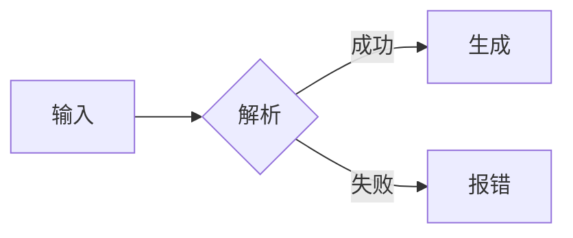

# GitHub 原生 Markdown 能力

能用原生能力表达的，就不要做成图片：原生内容可搜索、可复制、自动适配深浅色、零维护成本。

## 1. 提示框（Alerts）

```markdown
> [!NOTE]
> 一般说明。

> [!TIP]
> 可选的技巧。

> [!IMPORTANT]
> 用户必须知道的信息。

> [!WARNING]
> 可能导致问题的操作。

> [!CAUTION]
> 有风险或破坏性的操作。
```

用法建议：整篇 README 不超过 3 个；不要用来做装饰。

## 2. 折叠（details）

```html
<details>
<summary><b>其他安装方式</b></summary>

（这里必须空一行，Markdown 才会被解析）

```bash
brew install mytool
```

</details>
```

适合：备用安装方式、完整配置项、FAQ、更新日志摘要。

## 3. Mermaid 图

````markdown

````

- 适合简单流程、时序、状态图；GitHub 自动适配深浅色
- 无法自定义字体和细节样式；需要品牌感时改用 SVG 流程图
- 节点 ≤ 10 个，否则改成分段说明

## 4. 深浅色图片切换

```html
<picture>
  <source media="(prefers-color-scheme: dark)" srcset="assets/readme/hero-dark.svg">
  <source media="(prefers-color-scheme: light)" srcset="assets/readme/hero-light.svg">
  
</picture>
```

`` 的 `alt` 必须写完整的一句话定位，不能只写"hero"。

## 5. 居中与并排

```html
<p align="center">
  
</p>

<p align="center">
  <a href="#快速开始">快速开始</a> ·
  <a href="docs/">文档</a> ·
  <a href="examples/">示例</a>
</p>
```

截图并排：用 `<table>` 两列，每格一张 ``。

## 6. 其他

- `<kbd>Ctrl</kbd> + <kbd>K</kbd>`：快捷键
- 脚注：`正文[^1]` + `[^1]: 说明`
- 任务列表：`- [x] 已完成`（适合 Roadmap）
- 数学公式：`$E=mc^2$`、`$$…$$`（研究类项目）
- `diff` 代码块：展示前后变化
- 表格对齐：`| :-- | :-: | --: |`

## 7. 选择指引

| 需要表达 | 首选 | 何时改用 SVG |
|---|---|---|
| 步骤流程 | Mermaid / 有序列表 | 需要品牌一致性的主流程图 |
| 前后对比 | 表格 / `diff` 代码块 | 视觉效果本身就是卖点 |
| 警示 | Alerts | 不改 |
| 架构图 | Mermaid | 节点多于 10 个或需要分层视觉 |
| 章节分隔 | `##` 标题 | 视觉重量 L2 及以上 |
